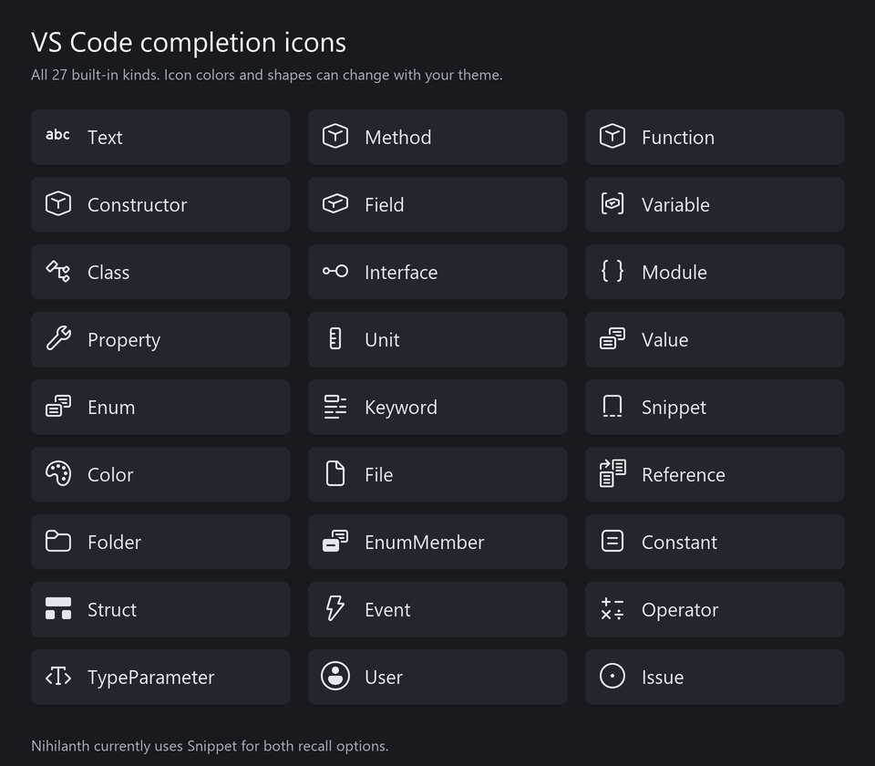

<div align="center">


# Nihilanth Toolbox

**An offline, editor-first developer toolbox crafted for VS Code**

*Recall removed code, reuse snippets, generate dummy data, and transform selections — directly at your cursor.*

<p>
  <a href="LICENSE"></a>
  
  
  
  
  
</p>

---

<p>
  <a href="#-about-nihilanth-toolbox">About</a> •
  <a href="#-key-features">Features</a> •
  <a href="#-visual-tour">Visual Tour</a> •
  <a href="#-installation--quick-start">Installation</a> •
  <a href="#-slash-commands-reference">Slash Commands</a> •
  <a href="#-dummy-data--type-mocking">Dummy Data</a> •
  <a href="#-selection-transformations">Transformations</a> •
  <a href="#-configuration--storage">Configuration</a> •
  <a href="#-building--development">Building</a> •
  <a href="#-icon--design-philosophy">Design</a> •
  <a href="#-license">License</a>
</p>

<picture>
  
</picture>

</div>

---

## 🐉 About Nihilanth Toolbox

**Nihilanth Toolbox** is an offline, editor-first productivity toolkit built specifically for VS Code developers. It lives right inside your coding flow—operating entirely at your cursor through intuitive slash commands, context actions, and automatic memory.

Modern developer tooling increasingly demands cloud accounts, external API keys, telemetry pipelines, and recurring subscriptions. Nihilanth takes the opposite approach: **100% local, private, and deterministic.**

- 🔒 **Zero Network & Complete Privacy**: Runs entirely on your machine. No telemetry pings, no cloud models, no API keys, and no subscriptions.
- ⚡ **Cursor-First Workflow**: Invoke commands by typing `/` on a line or pressing `Ctrl+Alt+Space` without switching windows or opening web browsers.
- 🕒 **Automatic Code Memory**: Seamlessly observes your workspace and preserves declarations and deleted code fragments so you never lose lost work.
- 🎲 **Instant Test Mocking**: Generate structured arrays, objects, and TypeScript type-driven mock datasets in milliseconds.
- 🛡️ **Safe & Non-Destructive**: Preview generated code and declarations before inserting; all actions cleanly integrate with native VS Code **Undo**.

---

## ✨ Key Features

<table>
  <tr>
    <td width="50%">
      <h3>🕒 Automatic Code Memory</h3>
      <p>Passively captures declarations and deleted code fragments (&gt;24 chars) across JS/TS/JSX/TSX files. Recalls both identifier names and full implementations starting from just 2 typed letters.</p>
    </td>
    <td width="50%">
      <h3>📌 Cross-Project Snippet Pins</h3>
      <p>Pin reusable blocks of code with custom aliases, tags, and dynamic VS Code placeholder syntax (<code>${1:param}</code>). Pinned items persist across projects and never expire.</p>
    </td>
  </tr>
  <tr>
    <td width="50%">
      <h3>🎲 Deterministic Dummy Data</h3>
      <p>Generate arrays or single instances of common data models (users, products, emails, dates, numbers) with seed reproducibility (<code>--seed=42</code>) and edge-case testing modes.</p>
    </td>
    <td width="50%">
      <h3>🧬 TypeScript Type Mocking</h3>
      <p>Parse local TypeScript interfaces, types, unions, and tuples directly at your cursor. Run <code>/data from User 5</code> to produce structurally matched mock JSON or JS objects.</p>
    </td>
  </tr>
  <tr>
    <td width="50%">
      <h3>🔄 Selection Transformations</h3>
      <p>Instantly convert between JSON and JS object literals, generate TypeScript types from raw JSON, deduplicate primitive arrays, and switch naming cases (camel, Pascal, snake, kebab).</p>
    </td>
    <td width="50%">
      <h3>🐉 Nihilanth Dragon Theme</h3>
      <p>Includes a dedicated status-bar launcher and an optional bespoke dragon product icon theme for custom suggestion badges.</p>
    </td>
  </tr>
</table>

---

## 📸 Visual Tour

### 1. Cursor-Native Suggestions &amp; Auto-Recall
Type two letters of any previously written identifier (even after deleting it) to summon its name or complete code body right alongside standard language suggestions.

<p align="center">
  
</p>

### 2. Status-Bar Launcher &amp; Product Icon Theme
Quickly trigger toolbox actions via the bottom-right status bar dragon or enable the **Nihilanth Dragon** product icon theme for custom Event completion badges.

<p align="center">
  
</p>

### 3. Fast In-Editor Slash Commands
Type `/` on a fresh line in JavaScript, TypeScript, or JSON files to access recall, pinned snippets, and data generation commands:

```text
/recall authService
/snippet fetch
/data users 5 --format=json
/data from Order 3 --format=json --seed=101
```

---

## 🚀 Installation &amp; Quick Start

### Installing the VSIX Package

#### Method A: Via VS Code GUI
1. Open the **Extensions** view in VS Code (`Ctrl+Shift+X` or `Cmd+Shift+X`).
2. Click the **…** (Views and More Actions) menu in the top-right corner.
3. Select **Install from VSIX…**.
4. Choose `nihilanth-toolbox-0.1.5.vsix` from this folder.

#### Method B: Via PowerShell / Terminal
```powershell
code --install-extension .\nihilanth-toolbox-0.1.5.vsix
```

### Enabling the Dragon Product Icon Theme (Optional)

To display the teal dragon head beside toolbox suggestions:
1. Open the Command Palette (`Ctrl+Shift+P` / `Cmd+Shift+P`).
2. Run **Preferences: Product Icon Theme**.
3. Select **Nihilanth Dragon**.

*(Note: Other product icons gracefully fall back to VS Code defaults; switching back to default restores default Event icons while retaining the status-bar dragon).*

### Keyboard Shortcuts

| Shortcut (Windows / Linux) | Shortcut (macOS) | Action |
| :--- | :--- | :--- |
| <kbd>Ctrl</kbd> + <kbd>Alt</kbd> + <kbd>Space</kbd> | <kbd>Cmd</kbd> + <kbd>Alt</kbd> + <kbd>Space</kbd> | Open toolbox suggestions at cursor (or selection menu when text is selected) |
| `/` (at start of dedicated line) | `/` (at start of dedicated line) | Trigger slash command completion list |
| <kbd>Esc</kbd> | <kbd>Esc</kbd> | Dismiss toolbox suggestions |

---

## ⚡ Slash Commands Reference

Nihilanth commands are activated by typing `/` at the beginning of a dedicated line (leading indentation is supported). The extension evaluates suggestions dynamically as you type arguments.

### Command Table

| Command | Arguments | Description | Example |
| :--- | :--- | :--- | :--- |
| `/recall` | `<query> [--project=current]` | Search stored identifiers, code, and removed declarations by name, tag, or path. | `/recall userAuth` |
| `/snippet` | `<alias \| tag> [--project=current]` | Insert a pinned snippet across workspaces. Supports TabStop placeholders. | `/snippet fetch` |
| `/data` | `<preset> [count] [flags]` | Generate synthetic test data from built-in schema presets. | `/data users 10 --format=json` |
| `/data from` | `<Type> [count] [flags]` | Parse a local TypeScript type or interface and generate matching mock data. | `/data from User 5 --format=json` |

### Automatic Memory Recall

- **Name vs Code**: Each recognized declaration offers both `identifier — name` (inserts just the identifier) and `identifier — code` (inserts the complete declaration).
- **Two-Character Auto-Trigger**: Typing two characters of an identifier in JS/TS automatically displays memory suggestions—no slash required.
- **Safety First**: Skipped inside strings, comments, and regex literals to avoid unwanted suggestions.

---

## 🎲 Dummy Data &amp; Type Mocking

### Built-in Presets

| Plural (Generates Array) | Singular (Generates Single Value / Object) |
| :--- | :--- |
| `users`, `products` | `user`, `product` |
| `names`, `emails`, `ids` | `name`, `email`, `id` |
| `numbers`, `dates`, `booleans`, `strings` | `number`, `date`, `boolean`, `string` |

### Generation Options &amp; Edge Cases

```text
/data emails 10
/data products 4 --format=json
/data dates 3 --seed=42
/data strings 2 --edge=long
/data numbers 10 --edge=boundary
/data users --edge=empty
```

- `--format=json`: Emits strict JSON with quoted keys.
- `--format=js`: Emits native JavaScript / TypeScript object literals.
- `--seed=<number>`: Creates deterministic, reproducible pseudo-random output.
- `--edge=empty`: Generates an empty array.
- `--edge=long`: Stretches string fields to boundary test limits.
- `--edge=boundary`: Uses extreme numeric limits (0, negative, max safe integers).

### Type-Driven Generation from Local TypeScript Types

Define your type or interface anywhere in the active file:

```ts
type User = {
  name: string;
  email: string;
  age?: number;
  role: 'admin' | 'guest';
  tags: string[];
};
```

On a new line, type:

```text
/data from User 5 --format=json --seed=42
```

> [!NOTE]
> Supported type constructs include primitives, literal unions, nested objects, tuples, optional fields, and `Array<T>`. Complex imported types, recursive types, and runtime classes like `Date` will provide a clear inline notice instead of fabricating incorrect schema values.

You can also highlight any type declaration or sample object literal and run **Nihilanth Toolbox: Generate Data from Selection** from the right-click menu.

---

## 🔄 Selection Transformations

Select any block of text, right-click, and choose **Transform Selection** (or press <kbd>Ctrl</kbd>+<kbd>Alt</kbd>+<kbd>Space</kbd>):

| Transformation | Details |
| :--- | :--- |
| **JSON ↔ JS Object** | Seamlessly toggle between strict JSON format and clean JS object literals. |
| **Extract Keys / Values / Entries** | Pull out object keys, values, or `[key, value]` pairs from selected objects. |
| **JSON → TypeScript Type** | Automatically generate a typed `type GeneratedType = { ... }` interface from a JSON sample. |
| **Deduplicate Array** | Remove duplicates from selected primitive lists or arrays. |
| **Case Conversions** | Switch casing between `camelCase`, `PascalCase`, `snake_case`, and `kebab-case`. |

*All transformations operate purely on the selected text and are fully reversible via native Undo (`Ctrl+Z`).*

---

## ⚙️ Configuration &amp; Storage

### User Settings

Configure Nihilanth in your VS Code settings under `nihilanth.*`:

| Setting | Default | Description |
| :--- | :--- | :--- |
| `nihilanth.prefix` | `"/"` | The character sequence used to trigger slash commands on dedicated lines. |
| `nihilanth.captureEnabled` | `true` | Automatically record observed declarations and deleted fragments. |
| `nihilanth.historyLimitMB` | `100` | Storage cap in MB for automatic memory. Oldest items are evicted; pins never expire. |
| `nihilanth.defaultCount` | `5` | Default number of items generated for array presets. |
| `nihilanth.maxDocumentKB` | `512` | Upper file size limit (in KB) for automatic observation. |
| `nihilanth.excludedFolders` | `["node_modules", ".git", "dist", "out", "build", "coverage"]` | Folders excluded from capture. |
| `nihilanth.excludedFiles` | `[".env", ".env.local"]` | Specific files ignored to safeguard secrets. |

### Memory &amp; Storage Architecture

- **Global Extension Storage**: Stored as a versioned JSON database in VS Code's local global-storage folder (`globalStorage`).
- **Completely Isolated**: History never enters your Git repositories, workspace files, or Settings Sync.
- **Concurrency Safe**: Utilizes locked, atomic file writes across multiple VS Code windows.
- **Management Palette**:
  - `Nihilanth Toolbox: Manage Memory and Snippets` — Browse, filter, pin, edit, or purge entries.
  - `Nihilanth Toolbox: Pause / Resume Code Capture` — Temporarily halt automatic observation.
  - `Nihilanth Toolbox: Clear Automatic History` — Wipe unpinned history while keeping saved snippets intact.

---

## 🛠️ Building &amp; Development

### Prerequisites

- **Node.js** (v22 or later)
- **VS Code** (v1.100 or later)

### Build Commands

```powershell
# Install dependencies
npm ci

# Run core test suite
npm test

# Run end-to-end integration tests (launches isolated VS Code instance)
npm run test:integration

# Build and package VSIX distribution
npm run package
```

### Debugging with F5 Host

Press <kbd>F5</kbd> in this workspace to launch an isolated **Extension Development Host**. Integration tests run against their own clean environment without modifying your local profile or existing history.

---

## 🎨 Icon &amp; Design Philosophy

<p align="center">
  
</p>

> *"A sharp, luminous teal dragon head engineered for developers who value speed, privacy, and editor-native autonomy."*

- **Teal Silhouette (`#2dd4bf`)**: High-contrast geometric vector crafted for maximum clarity across VS Code themes, completion popups, and the status bar.
- **Embedded Font Glyph**: Lightweight TrueType icon (`media/nihilanth-icons.ttf`) for instant native rendering in VS Code product themes without bitmap blur.
- **Quiet Utility**: Built to remain unobtrusive until summoned at your cursor.

---

## 📜 License

Distributed under the **[MIT License](LICENSE)**.

Copyright &copy; 2026 Nihil.
All rights reserved.
