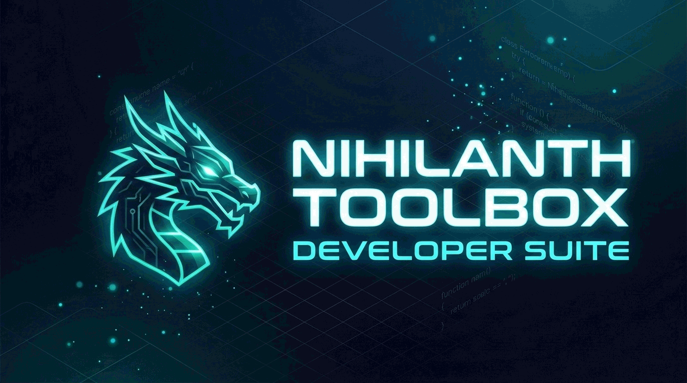
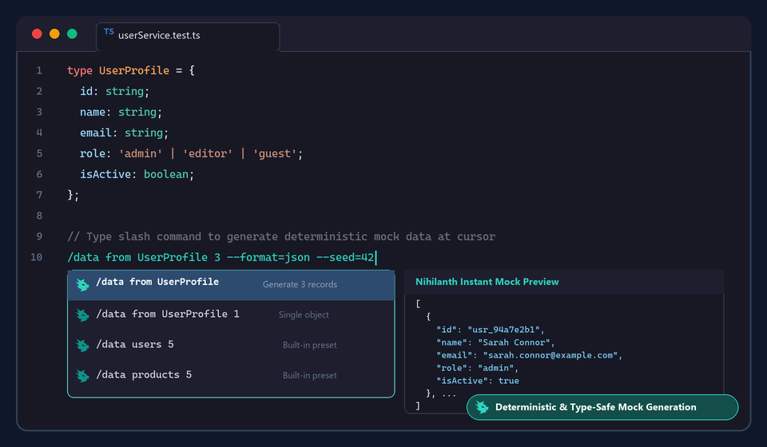
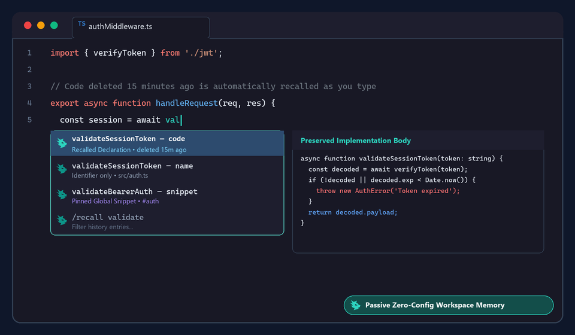
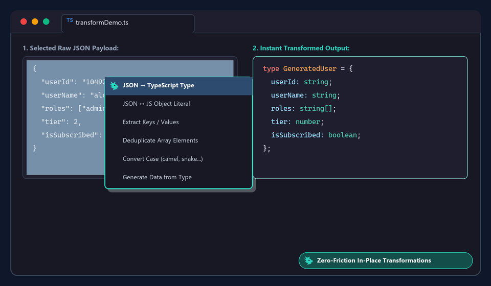
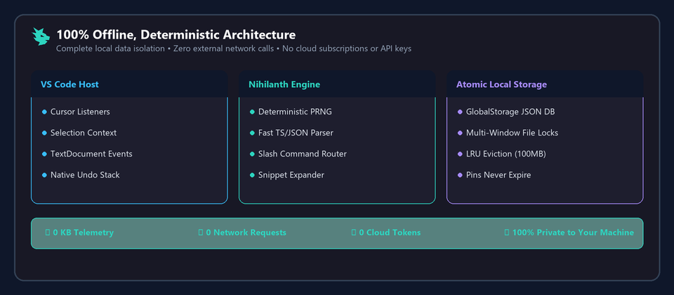

<div align="center">

<p align="center">
  
</p>

# Nihilanth Toolbox

**The offline, editor-first developer suite crafted for VS Code**

*Recall removed code, pin cross-project snippets, generate type-driven mock data, and transform selections — directly at your cursor.*

<p align="center">
  <a href="https://marketplace.visualstudio.com/items?itemName=Nihilnia.nihilanth-toolbox"></a>
  <a href="LICENSE"></a>
  
  
  
</p>

---

<p align="center">
  <a href="#-quick-start-in-30-seconds">Quick Start</a> •
  <a href="#-visual-feature-tour">Visual Tour</a> •
  <a href="#-key-capabilities">Capabilities</a> •
  <a href="#-slash-commands-reference">Slash Commands</a> •
  <a href="#-dummy-data--type-mocking">Data Generation</a> •
  <a href="#-selection-transformations">Transformations</a> •
  <a href="#-privacy--offline-architecture">Architecture</a> •
  <a href="#-settings--configuration">Settings</a> •
  <a href="#-license">License</a>
</p>

</div>

---

## ⚡ Quick Start in 30 Seconds

```shell
code --install-extension Nihilnia.nihilanth-toolbox
```

1. **Summon Slash Commands**: On a dedicated line in any `.ts`, `.js`, or `.json` file, type `/` or press <kbd>Ctrl</kbd>+<kbd>Alt</kbd>+<kbd>Space</kbd> (<kbd>Cmd</kbd>+<kbd>Alt</kbd>+<kbd>Space</kbd> on macOS).
2. **Instant Dummy Data**: Type `/data users 3 --format=json` and hit <kbd>Tab</kbd> or <kbd>Enter</kbd>.
3. **Type-Driven Mocking**: Highlight or define any TypeScript `type` or `interface` and run `/data from UserProfile 5`.
4. **Recall Lost Code**: Accidentally delete a function or type declaration? Just type the first two letters of its name anywhere in your project to restore it.

---

## 📸 Visual Feature Tour

### 1. Type-Driven Mock Data &amp; Slash Commands
Parse local TypeScript interfaces, types, unions, and tuples directly at your cursor to generate deterministic, structurally matched mock datasets in milliseconds.

<p align="center">
  
</p>

---

### 2. Automatic Workspace Code Memory
Passively observes declarations and deleted code fragments (&gt;24 characters) across JS/TS/JSX/TSX files. As soon as you type two letters of any past identifier, Nihilanth offers both the standalone identifier name and the complete implementation body.

<p align="center">
  
</p>

---

### 3. Selection Transformations
Select any snippet or JSON payload and press <kbd>Ctrl</kbd>+<kbd>Alt</kbd>+<kbd>Space</kbd> (or right-click) to trigger instant transformations: convert JSON to TypeScript types, switch JSON to JS object literals, deduplicate arrays, extract keys, or convert naming conventions.

<p align="center">
  
</p>

---

### 4. 100% Offline &amp; Private Architecture
Your code never leaves your workstation. No background telemetry pings, no cloud models, no API quotas, and no subscription paywalls.

<p align="center">
  
</p>

---

## 🌟 Key Capabilities

<table>
  <tr>
    <td width="50%">
      <h3>🕒 Automatic Workspace Code Memory</h3>
      <p>Passively captures function, class, type, and interface declarations as well as deleted blocks across your files. Restores deleted implementations right from your cursor suggestions.</p>
    </td>
    <td width="50%">
      <h3>📌 Cross-Project Snippet Pins</h3>
      <p>Save reusable code blocks with custom aliases, tags, and dynamic VS Code placeholder syntax (<code>${1:param}</code>). Pinned snippets are available across all workspaces and never expire.</p>
    </td>
  </tr>
  <tr>
    <td width="50%">
      <h3>🎲 Deterministic Dummy Data</h3>
      <p>Generate arrays or single instances of common schemas (users, products, emails, IDs, timestamps) with reproducible seed control (<code>--seed=42</code>) and edge-case boundary testing.</p>
    </td>
    <td width="50%">
      <h3>🧬 TypeScript Type Mocking</h3>
      <p>Understands your active file's TypeScript AST. Run <code>/data from &lt;Type&gt; [count]</code> to produce conforming mock data with zero manual configuration.</p>
    </td>
  </tr>
  <tr>
    <td width="50%">
      <h3>🔄 Selection Transformations</h3>
      <p>Instantly convert between strict JSON and JavaScript object literals, infer TypeScript types from JSON payloads, deduplicate arrays, and switch casing (camel, Pascal, snake, kebab).</p>
    </td>
    <td width="50%">
      <h3>🐉 Nihilanth Dragon Theme &amp; Status Launcher</h3>
      <p>Features an embedded vector dragon status bar launcher and an optional bespoke product icon theme for sleek, high-contrast suggestion badges.</p>
    </td>
  </tr>
</table>

---

## ⌨️ Keyboard Shortcuts &amp; Context Actions

| Shortcut (Win / Linux) | Shortcut (macOS) | Context | Action |
| :--- | :--- | :--- | :--- |
| <kbd>Ctrl</kbd> + <kbd>Alt</kbd> + <kbd>Space</kbd> | <kbd>Cmd</kbd> + <kbd>Alt</kbd> + <kbd>Space</kbd> | Editor (no selection) | Open toolbox completion suggestions at cursor |
| <kbd>Ctrl</kbd> + <kbd>Alt</kbd> + <kbd>Space</kbd> | <kbd>Cmd</kbd> + <kbd>Alt</kbd> + <kbd>Space</kbd> | Editor (text selected) | Open Selection Transformation quick-pick menu |
| `/` | `/` | Start of dedicated line | Trigger slash command completions |
| <kbd>Esc</kbd> | <kbd>Esc</kbd> | Completion widget | Dismiss suggestions |

You can also right-click anywhere in the editor to access:
- **Nihilanth Toolbox: Open at Cursor**
- **Nihilanth Toolbox: Pin Selection as Snippet**
- **Nihilanth Toolbox: Transform Selection**
- **Nihilanth Toolbox: Generate Data from Selection**

---

## ⚡ Slash Commands Reference

Type `/` at the beginning of a dedicated line (leading indentation is preserved). Suggestions filter dynamically as you type arguments.

### Supported Commands

| Command | Arguments | Description | Example |
| :--- | :--- | :--- | :--- |
| `/recall` | `<query> [--project=current]` | Search stored identifiers, declarations, and deleted code fragments. | `/recall authService` |
| `/snippet` | `<alias \| tag> [--project=current]` | Insert a pinned snippet across workspaces. Expands TabStops. | `/snippet fetchUsers` |
| `/data` | `<preset> [count] [flags]` | Generate synthetic test data from built-in schemas. | `/data users 5 --format=json` |
| `/data from` | `<Type> [count] [flags]` | Parse a local TypeScript type or interface and output conforming mock data. | `/data from Order 3 --seed=101` |

### Built-in Presets

| Plural (Generates Array) | Singular (Generates Single Value / Object) |
| :--- | :--- |
| `users`, `products` | `user`, `product` |
| `names`, `emails`, `ids` | `name`, `email`, `id` |
| `numbers`, `dates`, `booleans`, `strings` | `number`, `date`, `boolean`, `string` |

### CLI Flags &amp; Edge Cases

- `--format=json`: Emits strict JSON with quoted keys.
- `--format=js`: Emits native JavaScript / TypeScript object literals.
- `--seed=<number>`: Creates deterministic, 100% reproducible pseudo-random output.
- `--edge=empty`: Generates an empty array (tests zero-state UI).
- `--edge=long`: Stretches string fields to extreme lengths (tests UI overflow & wrapping).
- `--edge=boundary`: Uses extreme numeric limits (`0`, `-1`, `Number.MIN_SAFE_INTEGER`, `Number.MAX_SAFE_INTEGER`).

---

## 🔄 Selection Transformations Reference

Highlight any text and press <kbd>Ctrl</kbd>+<kbd>Alt</kbd>+<kbd>Space</kbd> or choose **Transform Selection**:

| Transformation | Description |
| :--- | :--- |
| **JSON ↔ JS Object** | Seamlessly toggle between strict JSON format and clean JS object literals. |
| **JSON → TypeScript Type** | Infers and generates a clean `type GeneratedType = { ... }` from a JSON sample. |
| **Extract Keys / Values / Entries** | Pulls out object keys, values, or `[key, value]` tuple pairs from selected objects. |
| **Deduplicate Array** | Removes duplicates from selected primitive lists or JSON arrays. |
| **Case Conversions** | Switch text between `camelCase`, `PascalCase`, `snake_case`, and `kebab-case`. |

*All transformations operate purely in memory on the selected text and are fully reversible with native **Undo** (<kbd>Ctrl</kbd>+<kbd>Z</kbd>).*

---

## 🐉 Dragon Product Icon Theme (Optional)

<p align="center">
  
</p>

To display the custom teal dragon glyph beside Nihilanth completion items:
1. Open the Command Palette (<kbd>Ctrl</kbd>+<kbd>Shift</kbd>+<kbd>P</kbd> / <kbd>Cmd</kbd>+<kbd>Shift</kbd>+<kbd>P</kbd>).
2. Run **Preferences: Product Icon Theme**.
3. Select **Nihilanth Dragon**.

*(Standard VS Code icons gracefully fall back to defaults; switching themes retains the dragon launcher in your status bar).*

---

## ⚙️ Settings &amp; Configuration

Configure Nihilanth in your VS Code settings (`settings.json`):

| Setting | Default | Description |
| :--- | :--- | :--- |
| `nihilanth.prefix` | `"/"` | The character sequence used to trigger slash commands on dedicated lines. |
| `nihilanth.captureEnabled` | `true` | Automatically record observed declarations and deleted fragments. |
| `nihilanth.historyLimitMB` | `100` | Storage cap in MB for automatic memory. Least recently seen or used items are evicted first; pins never expire. |
| `nihilanth.defaultCount` | `5` | Default number of items generated for array presets. |
| `nihilanth.maxDocumentKB` | `512` | Upper file size limit (in KB) for automatic AST observation. |
| `nihilanth.excludedFolders` | `["node_modules", ".git", "dist", "out", "build", "coverage"]` | Folders excluded from capture. |
| `nihilanth.excludedFiles` | `[".env", ".env.local"]` | Specific files ignored to safeguard secrets. |

---

## 🛡️ Privacy &amp; Storage Architecture

- **Local Storage Only**: Memory entries are stored unencrypted in VS Code's local extension `globalStorage` as a versioned, append-only JSON Lines log (`memory-v2.jsonl`). Older `memory-v1.json` databases are migrated automatically and kept as `memory-v1.json.migrated`.
- **Isolated from Source Control**: History is never committed to Git, workspace files, or Settings Sync.
- **Concurrency Safe**: Locked appends and atomic compaction keep the log consistent across multiple open VS Code windows. A damaged database is never overwritten; Nihilanth offers to move it aside and start fresh.
- **Secret Safeguards (best effort)**: Only JS/TS/JSX/TSX documents are observed, and excluded folders and files are skipped. Declarations and fragments that look like credentials (private keys, well-known token formats such as `sk-…`, `ghp_…`, `AKIA…`, or a string literal assigned to names like `apiKey`, `password`, `token`) are not captured. This is a heuristic — remembered code can be offered in other projects, so pause capture (or add exclusions) for sensitive codebases.
- **Untrusted Workspaces**: Automatic capture is paused until you trust the workspace; everything else keeps working.
- **Management Controls**:
  - `Nihilanth Toolbox: Manage Memory and Snippets` — Browse, filter, pin, or delete stored entries.
  - `Nihilanth Toolbox: Pause / Resume Code Capture` — Temporarily suspend code observation.
  - `Nihilanth Toolbox: Clear Automatic History` — Instantly purge unpinned history while preserving saved snippets.

---

## 📦 Distribution &amp; Installation

### Via Marketplace
Install directly from the [VS Code Marketplace](https://marketplace.visualstudio.com/items?itemName=Nihilnia.nihilanth-toolbox) or search `Nihilanth Toolbox` in the Extensions view (`Ctrl+Shift+X`).

### Via VSIX File
Download `nihilanth-toolbox-0.1.5.vsix` and install via command line:
```shell
code --install-extension nihilanth-toolbox-0.1.5.vsix
```
Or via the Extensions view: **…** menu → **Install from VSIX…**.

---

## 📜 License

Distributed under the **[MIT License](LICENSE)**.

Copyright &copy; 2026 Nihil. All rights reserved.
